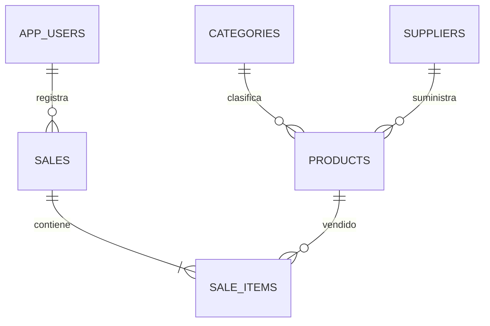

# Nexo · Sistema web de inventario

Aplicación en español con Java 21, Spring Boot 3.5, Spring Security, JPA, Flyway, MySQL 8.4 y una interfaz responsive en HTML, CSS y JavaScript sin framework.

## Puesta en marcha

Requisitos: Java 21, Docker con Compose, curl y acceso a Maven Central. `mvnw` descarga Maven 3.9.11 y comprueba su SHA-512. Si ya tienes Maven puedes usar `mvn`.

1. Copia `.env.example` a `.env`. Define contraseñas seguras para `DB_PASSWORD`, `MYSQL_ROOT_PASSWORD` y `ADMIN_PASSWORD` (mínimo 12 caracteres), y tu `ADMIN_EMAIL`. No publiques este archivo.
2. Ejecuta `docker compose up -d --wait`.
3. Ejecuta `./mvnw clean verify`.
4. Inicia con `./scripts/run.sh`. La aplicación escucha en el puerto 8080. Abre su dirección en tu instalación local o usa el mecanismo de acceso de tu servidor.

En este entorno cloud utiliza `./scripts/cloud-maven.sh verify` para respetar el proxy de red. Los archivos de caché y configuración local quedan ignorados por Git. El Java del entorno debe confiar en la CA del proxy; nunca desactives la comprobación TLS.

`run.sh` carga `.env` como archivo de shell de confianza; no uses un archivo de origen desconocido. Las variables también pueden inyectarse directamente. Para una base externa configura `DB_URL`, `DB_USER` y `DB_PASSWORD`; Docker no es obligatorio. Los secretos locales generados durante el desarrollo están en `.env` y no se muestran en logs.

El administrador inicial se crea únicamente cuando el correo configurado no existe. Cambiar `ADMIN_PASSWORD` posteriormente no cambia una contraseña guardada. El registro público siempre crea colaboradores. Los cambios de rol se aplican al volver a iniciar sesión.

## Funcionalidades y permisos

- Inicio de sesión por sesión HTTP, cierre de sesión y registro; BCrypt y protección CSRF en las operaciones de escritura.
- Panel con total de ventas, valor de inventario y alertas por stock mínimo.
- Productos con SKU único, precio decimal, existencias, categoría y proveedor. Búsqueda, alta, edición y eliminación.
- Categorías y proveedores con gestión completa por administradores.
- Ventas con varias líneas, detalle histórico, vendedor, fecha y total calculado en el servidor. Cualquier usuario autenticado puede vender y consultar el catálogo y el historial compartido del negocio.
- Administración de roles, sin posibilidad de cambiar el rol propio.
- Transacciones y bloqueo pesimista de productos en orden estable: una venta concurrente no puede dejar stock negativo. Una venta fallida revierte todas sus líneas. Los productos repetidos en una venta se rechazan.
- Las claves foráneas impiden borrar categorías/proveedores en uso o productos vendidos. Los nombres y precios de cada línea se conservan como datos históricos.

La moneda de presentación es COP. Los indicadores monetarios usan precios de venta, no costos contables. No incluye pagos, impuestos, facturación fiscal ni recuperación de contraseña por correo.

## Modelo de datos

La migración `src/main/resources/db/migration/V1__schema.sql` crea las tablas, índices, restricciones y relaciones. Hibernate valida el esquema; no lo modifica automáticamente. MySQL conserva los datos en el volumen `mysql_data`. `docker compose down` conserva el volumen; `down -v` lo destruye.

## API

`GET /api/csrf` proporciona token y nombre del encabezado. Conserva cookies y envía ese encabezado en POST/PUT/DELETE. `POST /api/login` recibe formulario `username`/`password`; al autenticar, solicita un token CSRF nuevo. `POST /api/register` recibe JSON `name,email,password`. `POST /api/logout` cierra la sesión.

| Recurso           | Operaciones                                           |
| ----------------- | ----------------------------------------------------- |
| `/api/me`         | GET usuario actual                                    |
| `/api/products`   | GET, POST; PUT/DELETE `/{id}`                         |
| `/api/categories` | GET, POST; PUT/DELETE `/{id}`                         |
| `/api/suppliers`  | GET, POST; PUT/DELETE `/{id}`                         |
| `/api/sales`      | GET, POST `{"items":[{"productId":1,"quantity":2}]}`  |
| `/api/users`      | GET, PUT `/{id}/role` con `{"role":"ADMIN"}` o `USER` |

Las escrituras del catálogo y la gestión de usuarios requieren ADMIN. Los errores de validación devuelven 400; autenticación 401; permisos/CSRF 403; inexistencia 404; duplicados, referencias y stock insuficiente 409.

## Pruebas y despliegue

`./mvnw verify` ejecuta pruebas de integración con H2 en modo MySQL: seguridad, registro, validación, catálogo, restricciones, ventas, rollback y concurrencia. No requieren Docker. Las migraciones y el arranque se deben comprobar además con MySQL real; H2 no sustituye esa comprobación.

Para producción configura HTTPS en el proxy inverso, `SERVER_SERVLET_SESSION_COOKIE_SECURE=true`, secretos fuera del repositorio, copias de seguridad y límites de acceso en el proxy. No expongas MySQL públicamente. La fuente web es opcional y dispone de fuentes de sistema de respaldo.

### Prueba de interfaz (opcional)

Con el servidor y MySQL iniciados: `npm ci`, `npx playwright install chromium` y `npm run test:ui`. Si Chromium ya está instalado, usa `CHROMIUM_PATH=/usr/bin/chromium npm run test:ui`. Node.js solo es necesario para esta prueba. Las credenciales del administrador se leen de las variables del entorno o del `.env` local. Crea registros claramente marcados `E2E` en la base elegida: ejecútala únicamente en desarrollo. Guarda capturas de escritorio y móvil en `test-results/`, que no se publica en Git.

Para repetir la suite Java con MySQL utiliza una **base exclusiva de pruebas** (la suite borra sus tablas entre casos): configura `TEST_DB_URL`, `TEST_DB_USER` y `TEST_DB_PASSWORD`, y ejecuta `./mvnw test`. Las variables son opcionales; por defecto usa H2 en memoria. No ejecutes esa suite contra una base con datos que quieras conservar.

La instancia cloud incluye credenciales locales aleatorias en `.env`; puedes consultarlas de forma privada o configurar tus propios valores antes de crear una base nueva. `./scripts/cloud-setup.sh` prepara el JDK completo, Maven, dependencias y pruebas de manera repetible; conserva el `.env` existente. La aplicación usa la zona horaria America/Bogota para mostrar ventas.
